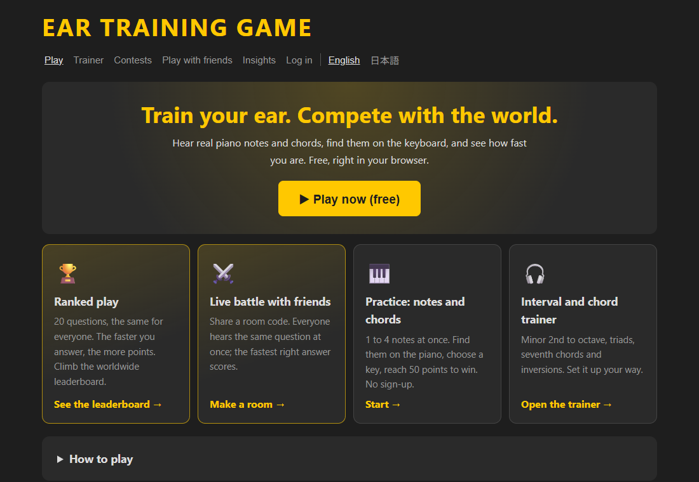
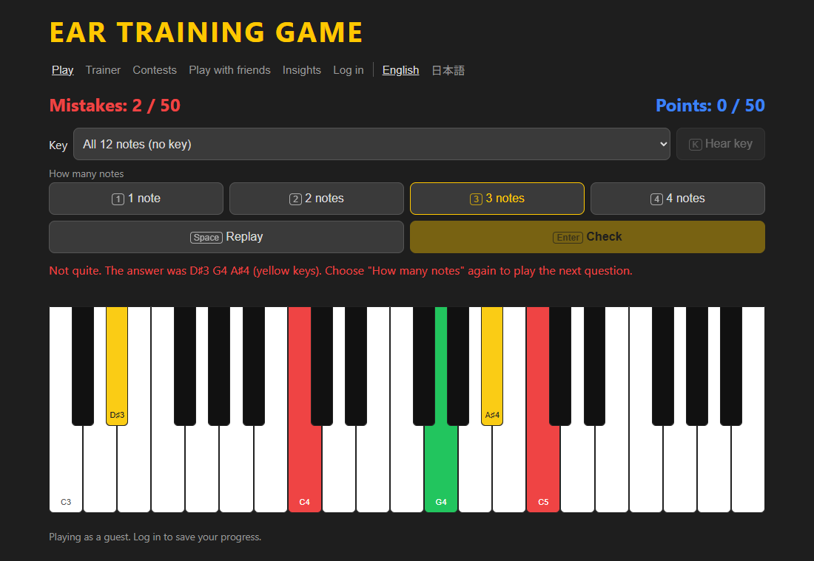
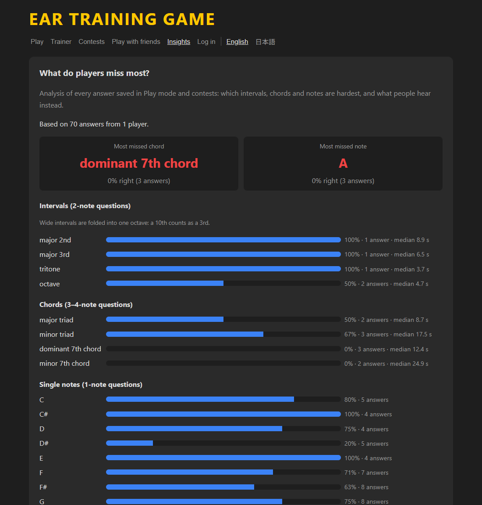

# Ear Training Game（聴音トレーニング）

**Live: [chouon-training.com](https://chouon-training.com)** · English: [chouon-training.com/en/](https://chouon-training.com/en/)

A free ear-training web game with real piano sounds: hear 1–4 notes, find them on the keyboard, and compete with
players worldwide or live with friends. In English and Japanese, on phones and computers.



| Playing: the answer is shown on the piano | Insights: what players miss most |
|---|---|
|  |  |

## Features

- **Play**: hear 1, 2, 3 or 4 notes (single notes, intervals, triads, seventh chords) and pick them on the piano.
  Choose a key (24 keys) to practice only its notes and chords. A right note in the wrong octave counts as half right.
- **Trainer**: name intervals (minor 2nd to octave), triads, seventh chords and inversions.
- **Ranked play, anytime**: 20 questions, the same length for everyone. Speed scoring: points shrink every split second.
  Weekly and all-time leaderboards; each run is played under the name you type for it.
- **Live battles with friends** (WebSockets): everyone hears the same question at once; the fastest right answers score.
- **Class competitions**: a teacher creates a contest and shares a join code.
- **Insights**: which intervals, chords and notes players miss most, and what they hear instead (see below).
- Accounts are optional (Supabase Auth); guests can practice without signing up.

## Play-data analysis

The **Insights** page ([chouon-training.com/en/](https://chouon-training.com/en/) → Insights) answers questions such as
*"Which interval is missed most often?"*, *"Which chord type takes longest to recognize?"* and *"Which note do players
hear when the answer is A?"*. Logged-in players can switch between everyone's data and their own.

Everything is computed in **PostgreSQL** from every saved answer, Play mode and contests together
([backend/app/analytics.py](backend/app/analytics.py), served by `GET /api/analytics?scope=everyone|me`):

| Question | How it is computed |
|---|---|
| Accuracy and answer time per number of notes | `GROUP BY mode`, `avg(result = 'right')`, median with `percentile_cont(0.5) WITHIN GROUP` |
| Hardest single notes | note letter → pitch class with a `VALUES` lookup table, accuracy and wrong-octave rate per pitch class |
| Hardest intervals (2-note questions) | note names → numbers (`unnest` + `LATERAL` join), span = max − min, folded into one octave |
| Hardest chord types (3–4 notes) | every played note is tried as the root; the pitch-class shape (`array_agg(DISTINCT … ORDER BY …)`) is matched against a table of chord types, so inversions and spread voicings are recognized |
| Most common confusions | 1-note questions answered with a different note name, counted per (played, answered) pair |

The two answer tables (Play and contests) are combined with `UNION ALL` in one shared set of CTEs, and the queries
are covered by tests with hand-made data ([backend/tests/test_analytics.py](backend/tests/test_analytics.py)).
Everyone's data is shown only as totals, never who answered what.

## Tech stack

| Part | Technology |
|---|---|
| Frontend | React 19, JavaScript, Vite, Tone.js (Web Audio) for the piano samples |
| Backend | Python, FastAPI, SQLAlchemy 2, Alembic migrations, WebSockets for live rooms, NumPy for mixing contest audio on the server (so the browser never sees the answer) |
| Database & auth | PostgreSQL on Supabase, Supabase Auth (JWT) |
| Hosting | Render (static website + Docker API), Cloudflare DNS |
| CI/CD | GitHub Actions: backend tests against a real PostgreSQL, frontend tests, lint and build, then deploy |
| Local development | Docker Compose (frontend, backend, database, test database) |

The full roadmap and the reasons behind each technology are in [docs/PLAN.md](docs/PLAN.md).

## Run it locally

Needs Docker Desktop running.

```
docker compose up --build
```

- Game (React): http://localhost:5173
- API test page (FastAPI): http://localhost:8000/docs

Stop it with `Ctrl+C`, or `docker compose down` if it runs in the background.

After adding a new library (`npm install ...` or a new line in `requirements.txt`), rebuild with:

```
docker compose up --build -V
```

(`-V` makes Docker reinstall the libraries instead of reusing the old ones.)

To play on your phone: connect it to the same Wi‑Fi, find your PC's IP address with `ipconfig`
(the "IPv4 Address", e.g. 192.168.1.20), and open `http://192.168.1.20:5173`.
If it doesn't load, allow Docker / port 5173 in the Windows Firewall.

## Accounts and the database (Supabase)

Without setup, everyone plays as a guest. To turn on accounts and saved progress:

1. Copy `.env.example` to `.env` and fill in the values from your Supabase project
   (the comments in the file say where to find each one). `.env` is never committed.
2. Restart: `docker compose up -d --force-recreate`
3. Create the tables: `docker compose exec backend alembic upgrade head`

When a table changes later, a new file is added in `backend/alembic/versions/`, and step 3 applies it.

## Online (Render + Supabase)

- `render.yaml` describes the two online services: the website (static site) and the API
  (Docker web service in Singapore, built from `backend/Dockerfile.prod`).
- Every push to `main` runs all tests on GitHub (`.github/workflows/tests.yml`); when they pass, GitHub Actions
  tells Render to deploy. The API runs the database migrations when it starts.
- Secrets (database password, deploy hooks) live only in Render's dashboard and GitHub secrets, never in the code.
- Every 3 hours `.github/workflows/keep-alive.yml` reads the production database and runs
  `scripts/supabase_watchdog.py`, which restores paused Supabase projects. It needs a Supabase personal access token
  in the GitHub secret `SUPABASE_ACCESS_TOKEN`; if the token expires, the run fails and GitHub sends an email.
  The same workflow makes the development project read its database so it stays awake (it can't restore that one).

## Tests

```
docker compose exec backend pytest     # Python: music logic, API, scoring, contests, live rooms, analysis (throwaway test database)
cd frontend && npm test                # JavaScript: game rules, guide-page quizzes
```

## Project layout

| Folder | What's inside |
|---|---|
| `frontend/` | React app (JavaScript, built with Vite) and the guide pages for search engines |
| `backend/` | Python API (FastAPI), migrations and tests |
| `scripts/` | Helper scripts, e.g. `convert_sounds.py` (WAV → MP3 for the web) |
| `sounds/` | Original WAV piano samples |
| `legacy/` | The original pygame version of the game |
| `docs/` | Project plan, exam syllabus draft, README screenshots |

## The original pygame version

The project started as a desktop game in Python/pygame, kept in `legacy/`:

1. Install Python (3.9 or later) and pygame: `pip install pygame`
2. Clone this repository: `git clone https://github.com/TakahiroOu/Ear-training-game.git`
3. Run it from the repository folder: `python legacy/main.py`
